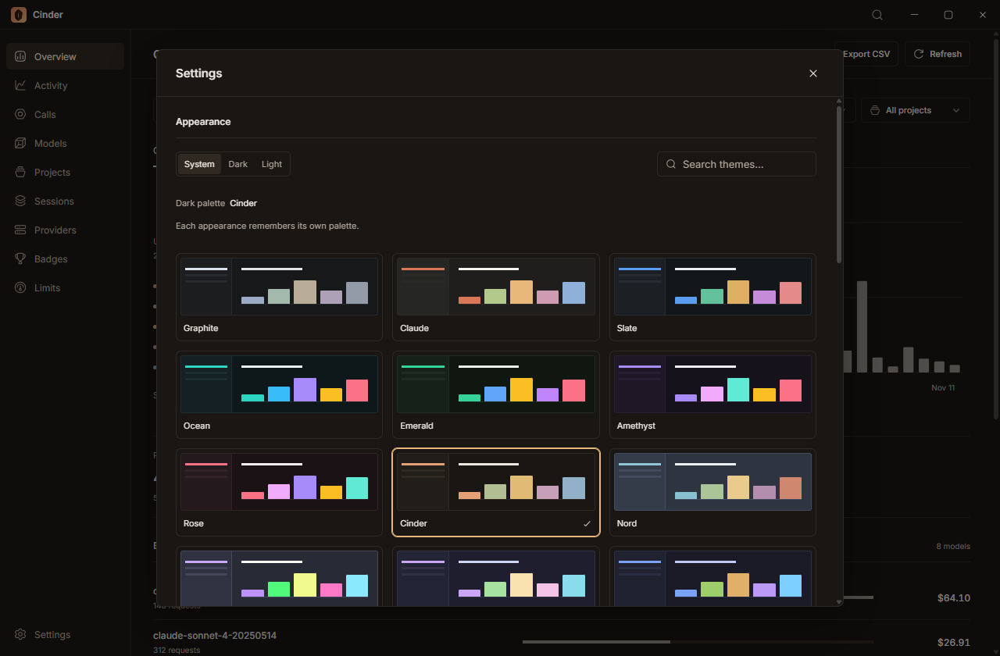

# Themes

Open **Settings > Appearance**, choose **Change theme** in Commands, or press **Ctrl/Cmd + Alt + A**.

Search by name or expand the first five previews. Cinder includes Graphite, Claude, Slate, Ocean, Emerald, Amethyst, Rose, Cinder, Nord, Dracula, Catppuccin, Tokyo Night, Solarized, Gruvbox and GitHub. Each has a light and dark palette.

Choose **System** to follow the OS, or select **Light** or **Dark**. Each appearance remembers its own palette. When System is selected, choosing a theme updates the currently active appearance.

Changes apply immediately and are saved on this device. **Ctrl/Cmd + Alt + Shift + A** cycles System, Light and Dark. Previously saved themes carry over to both appearances; unknown theme IDs fall back to Graphite.
