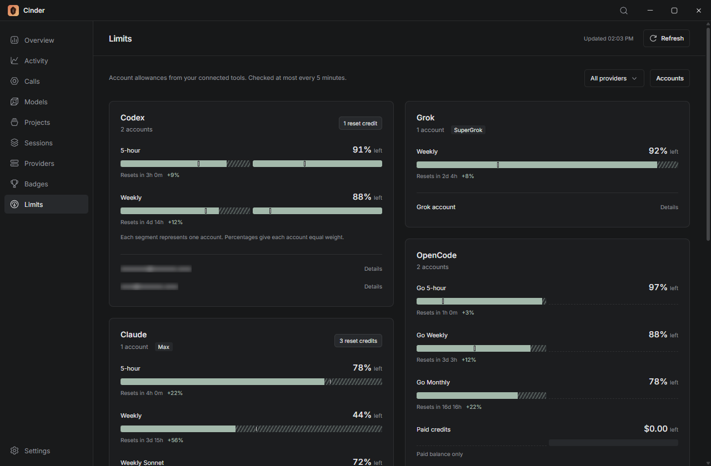
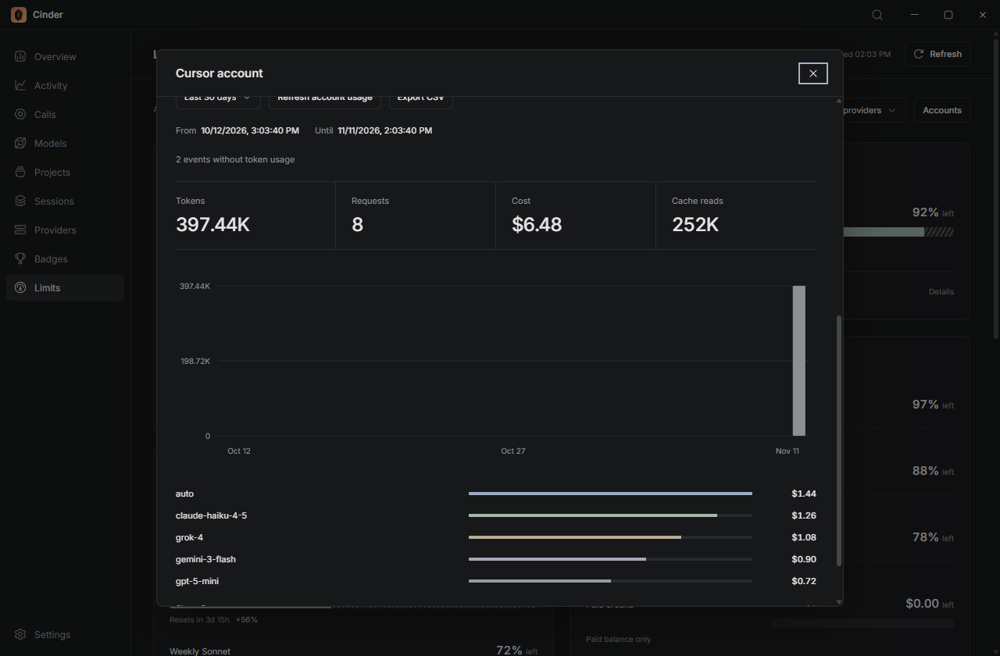

# Account limits

Open **Limits** or press **Ctrl/Cmd + 9**. Cinder uses existing tool logins to read quotas, reset times and credits. Sign in through the tool first, then refresh Cinder.

## Supported logins

| Provider    | Login                                                  |
| ----------- | ------------------------------------------------------ |
| Codex       | Installed Codex CLI with a ChatGPT account             |
| Claude      | Claude Code OAuth login                                |
| Cursor      | Desktop login, `CURSOR_AUTH_TOKEN` or `CURSOR_API_KEY` |
| Grok        | Default `grok login` subscription                      |
| OpenCode Go | Native Go credentials or `OPENCODE_API_KEY`            |
| OpenRouter  | API key in OpenCode's `auth.json`                      |
| Antigravity | Desktop Google login or an ACP account directory       |

Use **Accounts > Add account directory** for another local login. Removing a directory only removes Cinder's reference. Shared identities are deduplicated where the provider supplies an account ID.

If Codex CLI is not found, set `CINDER_CODEX_BIN` to its executable. Custom Claude/Grok endpoints and API-key connections do not provide subscription quotas. Native macOS Claude Keychain access is supported for the default home.

Expired logins must be renewed in the provider's app. For Antigravity ACP, add the directory containing `acp_token.json`, or its parent containing `antigravity-acp/`.

## Reading the bars

Each segment represents an account. Account columns stay aligned across windows; a gap means no reading for that account. Pooled percentages weight reporting accounts equally, even when plans have different capacities.

USD budgets show the remaining dollar amount. Known balances are summed across accounts. OpenRouter paid credits are separate from free-model access.

An exhausted weekly or monthly allowance can block a shorter window. Hatching shows what the next reported reset would restore. The thin marker compares remaining quota with time left in a known window. Missing, expired or stale reset times do not imply a full refill.

Open **Details** for the plan, login location, exact reset time and last successful check. Automatic checks run at most every five minutes while Limits is open. **Refresh** forces a check. Failed checks keep a marked last-known reading when available.

Emails and local paths are blurred. Click to reveal them, then click again to hide them.

## Reset credits

**Use a reset credit** opens a confirmation. It consumes one of the provider's finite credits; resets are never automatic. Claude may offer different reset types, each with its own description.

Cinder rechecks the account before sending the request. **Retry same reset** reuses the request key and selected grant after an interrupted response. The confirmation stays open while the request is pending, then quotas are refreshed.

## Cursor billing

Open a Cursor account and choose **Load account usage** for the last 7, 30 or 90 days. This shows billing events, tokens, costs and models, with a separate CSV export.

Billing data stays separate from local Cursor request and tool counts because their coverage differs. Missing token data is reported as omitted events.

## Data access

Local history scans work offline. Opening Limits or loading Cursor billing contacts the provider using its existing login. These requests do not send conversation logs or start an agent turn.

Credentials stay in native storage and worker memory. Cinder saves quota metadata, account names, paths and reset request identifiers in its own data directory, without bearer tokens.
