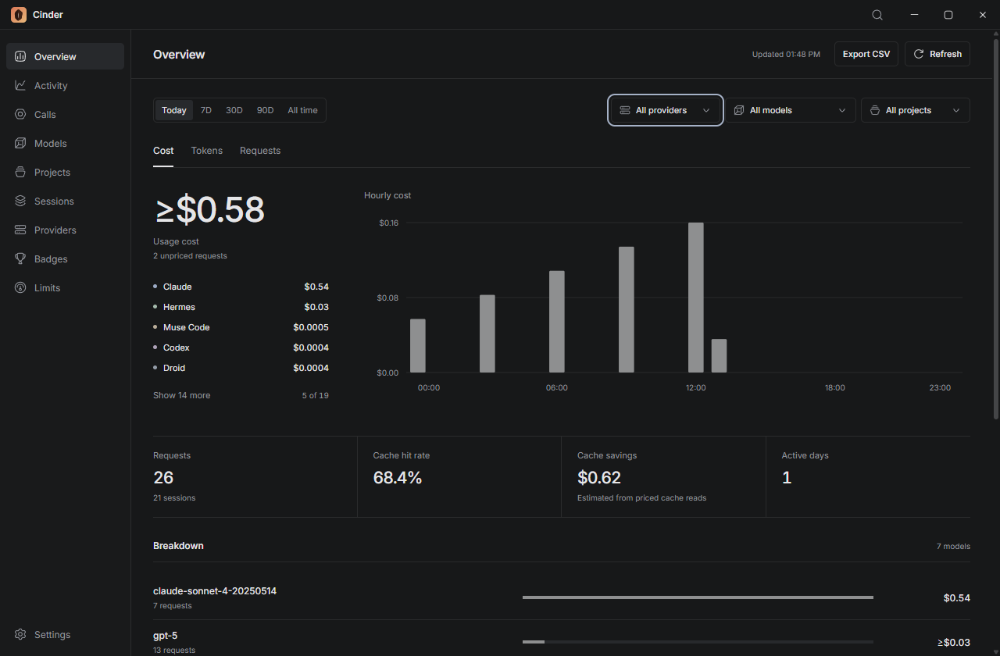
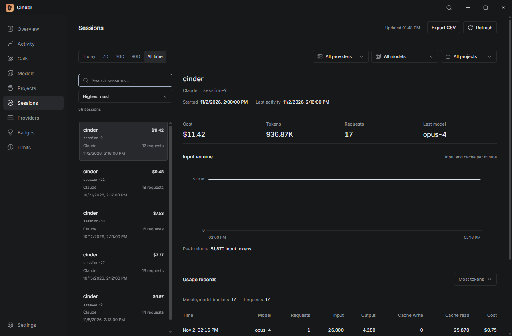
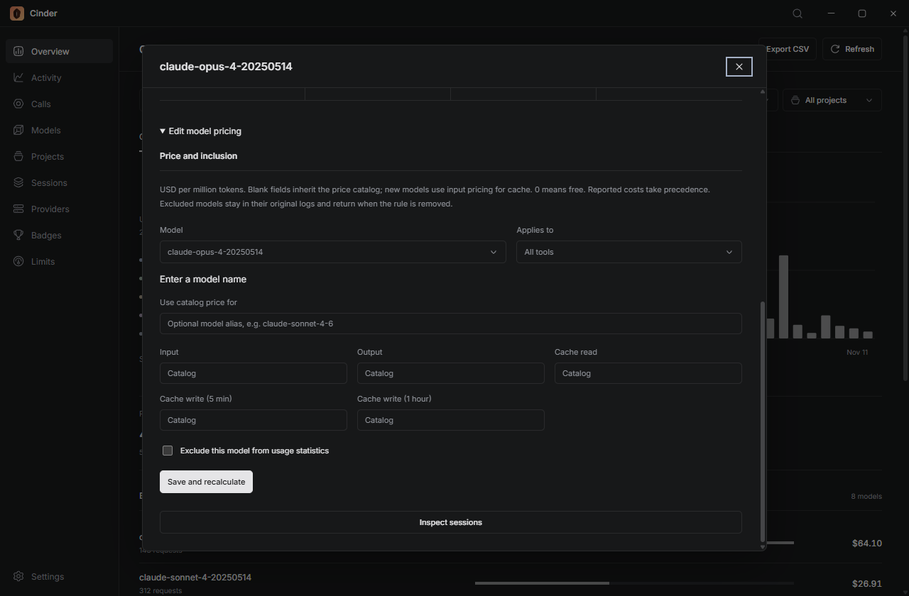

# Usage

On first launch, Cinder scans local tool history. Later launches can open the saved scan or start a new one. Refresh reads new records. Cancel stops the scan and keeps the previous saved result.

Unreadable files appear as scan warnings. A partial scan stays visible but does not replace the last complete snapshot.

## Filters and charts

Choose a period, then filter by provider, model or project. Filters combine, and their menus support search and keyboard navigation. The clear button resets those three filters while keeping the period.

Today uses local hours from 00:00 to 23:00. Longer periods use local calendar days, including today. Both occurrences of a repeated hour at the autumn clock change count toward that hour.

Cost, Tokens and Requests change the overview's chart and rankings together. Lists start with five entries; **Show more** expands them. Select a model for its trend, pricing and sessions.

Calls use all history, with a 90-day trend. Badges and streaks also use all history. Refresh in Calls reads calls only; Refresh in Limits checks quotas.

## Sessions

Search by project, session ID, tool or model. Sort sessions by cost, tokens, requests, project or recent activity. The detail shows usage records and input volume per minute.

Records with the same source, provider, model, speed, project, session and minute are grouped together. Request counts are preserved. The chart sums fresh input and cache for each minute; it does not measure the exact context-window size.

## Costs and pricing

Costs are in USD. Provider-reported costs take precedence, including zero. Otherwise Cinder estimates costs from its bundled price catalog. Unknown prices are marked **Unpriced**, or prefixed with **≥** when part of the cost is known. Estimates do not represent your subscription invoice.

Open **Settings > Model pricing**, or **Edit model pricing** in a model detail. Enter prices per million tokens, leave fields blank to inherit the catalog, or enter `0` for a free rate. A catalog alias changes the price lookup without renaming the recorded model. Rules can apply to one tool or all tools.

Saving recalculates history, including cached records. Reported costs remain unchanged. Excluding a model hides it from statistics; removing the rule brings it back without changing its logs.

Cache hit rate uses fresh input, cache reads and cache writes. Cache savings compare priced reads with fresh input at the same rate. Speed premiums are included in estimated costs. Reported costs without a token breakdown appear under **Other**.

## Counts

Input means fresh input; cache reads and writes are counted separately. Output includes reasoning when the source stores it separately. Claude streaming updates use the largest recorded counters. Codex cumulative counters become deltas. Pi and Muse reasoning is already included in output.

Session IDs are scoped to their tool. Session-total formats, such as Goose, Hermes and Droid, contribute one saved record per session. Missing logs, tokens and request counts cannot be reconstructed.

## Export and shortcuts

**Export CSV** exports the filtered usage, including token categories, costs, pricing status and speed. Cursor billing has its own export. Files use UTF-8 and escape spreadsheet formulas.

| Shortcut                   | Action                           |
| -------------------------- | -------------------------------- |
| Ctrl/Cmd + R               | Refresh the current data         |
| Ctrl/Cmd + 1-9             | Switch views                     |
| Ctrl/Cmd + K               | Search commands                  |
| Ctrl/Cmd + Alt + A         | Choose a theme                   |
| Ctrl/Cmd + Alt + Shift + A | Cycle appearance                 |
| Escape                     | Close the current menu or dialog |

Appearance, view, period, automatic refresh and window position are saved on this device. Automatic usage refresh is optional and off by default.
